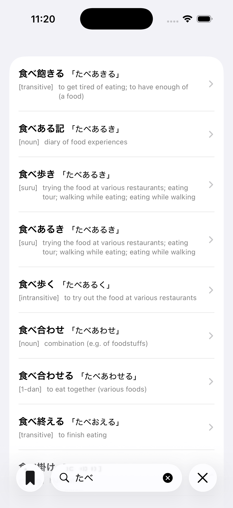
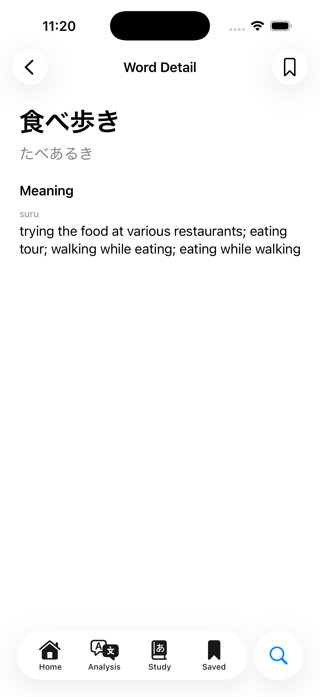
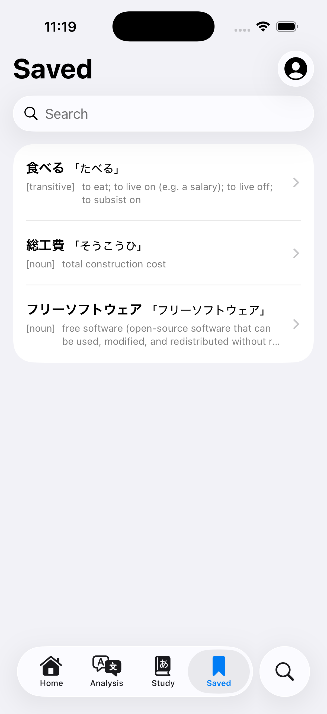
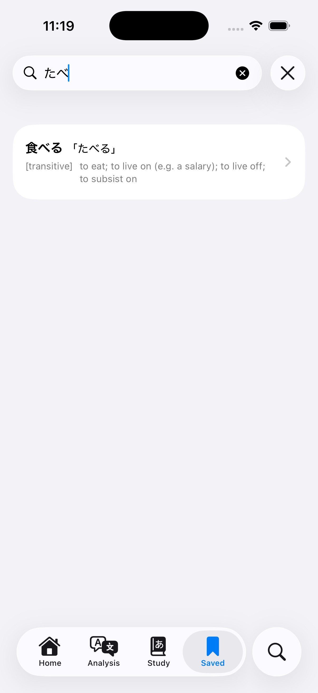

<h1 align="center">KotobaLab</h1>

<p align="center">
  A local-first Japanese dictionary and study app for iOS, built in SwiftUI.
</p>

<p align="center">
  <a href="https://github.com/shiinayane/KotobaLab/actions/workflows/ios-tests.yml"></a>
  <a href="https://github.com/shiinayane/KotobaLab/actions/workflows/builder-tests.yml"></a>
  
  
  <a href="LICENSE"></a>
  
</p>

> [!NOTE]
> KotobaLab is a personal project in active development. See [Current Work](docs/current_work.md) for the active objective and [Product](docs/product.md) for direction.

The dictionary ships as a bundled, indexed SQLite asset derived from JMdict via Jitendex, searched offline through GRDB. User data lives in a separate SwiftData store. The product prioritizes dictionary fidelity, stable identity, search quality, update safety, and daily usability before backend, AI, or broad study features.

> [!WARNING]
> The current asset is an MVP projection, not a source-complete dictionary model: distinct glosses are flattened into one meaning, extracted alternative forms are not stored, and saved data still references rebuild-dependent SQLite IDs. See [Dictionary](docs/dictionary.md).

## Screenshots

<p align="center">
  <table>
    <tr>
      <td></td>
      <td></td>
      <td></td>
      <td></td>
    </tr>
    <tr align="center">
      <td>Search</td>
      <td>Word Detail</td>
      <td>Saved</td>
      <td>Saved Search</td>
    </tr>
  </table>
</p>

## Getting Started

The dictionary database (`dictionary.sqlite`) is **not** committed to git. It is published as a GitHub Release artifact.

```bash
# 1. Clone (HTTPS — works without SSH keys; substitute git@github.com:... if you have SSH set up)
git clone https://github.com/shiinayane/KotobaLab.git
cd KotobaLab

# 2. Download the dictionary from the latest release
curl -L -o KotobaLab/Resources/dictionary.sqlite \
  https://github.com/shiinayane/KotobaLab/releases/latest/download/dictionary.sqlite

# 3. (Optional) Verify the checksum
curl -L -o KotobaLab/Resources/dictionary.sqlite.sha256 \
  https://github.com/shiinayane/KotobaLab/releases/latest/download/dictionary.sqlite.sha256
( cd KotobaLab/Resources && shasum -a 256 -c dictionary.sqlite.sha256 )

# 4. Open in Xcode and build
open KotobaLab.xcodeproj
```

Builder maintainers who regenerate the dictionary from source data should follow [Dictionary](docs/dictionary.md) instead.

## Documentation

| Document | Covers |
| --- | --- |
| [`AGENTS.md`](AGENTS.md) | Contributor and agent workflow, verification, Git conventions |
| [`docs/current_work.md`](docs/current_work.md) | Current objective, next action, open decisions |
| [`docs/product.md`](docs/product.md) | Product definition, v1 contract, long-term direction |
| [`docs/architecture.md`](docs/architecture.md) | Layering rules, concurrency, test ownership, known gaps |
| [`docs/dictionary.md`](docs/dictionary.md) | Data principles, build pipeline, release, measurements |
| [`docs/archive/`](docs/archive/) | Completed phase records |

## Attribution

KotobaLab ships derivative dictionary data from:

- [JMdict](https://www.edrdg.org/jmdict/j_jmdict.html) — the Japanese–Multilingual Dictionary maintained by the [Electronic Dictionary Research and Development Group](https://www.edrdg.org/).
- [jitendex-yomitan](https://github.com/stephenmk/jitendex) — Stephen Kraus' JMdict-derived Yomitan dictionary.

The shipped `dictionary.sqlite` is licensed under **CC BY-SA 4.0**, inheriting from upstream. This attribution also surfaces in-app under **Settings → License**.

## License

The application source code is licensed under the [MIT License](LICENSE) — you are free to use, modify, and distribute it, subject to the terms in `LICENSE`.

The shipped dictionary asset (`dictionary.sqlite`, published via GitHub Releases) is **independently licensed under CC BY-SA 4.0** and inherits the attribution and share-alike requirements of its upstream sources. The MIT license on the source code does not waive those requirements. See [Attribution](#attribution) for details.
